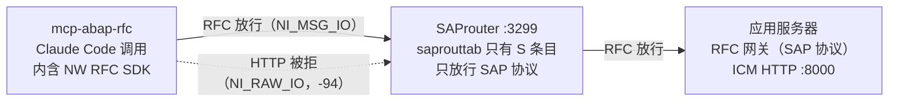

# 经 SAProuter 连接 SAP：mcp-abap-rfc 配置说明

适用于 SAP GUI 要填 router 串才能登录、本机无法直连应用服务器 HTTP 端口的系统。英文版的 RFC 安装说明见 [RFC_SETUP.md](RFC_SETUP.md)。

## 为什么必须走 RFC

SAP 系统只能经 SAProuter 访问时，HTTP 过不了这类 router，所以 mcp-abap-rfc 只走 RFC（它没有 HTTP 连接方式）。SAP GUI 能经 router 登录，只说明 router 放行 SAP 协议，不说明它放行 HTTP。

这是实测结论。我们用一个临时的 NI 协议探测脚本，对同一个 router 试了两种路由方式：

| 路由方式 | 目标端口 | router 的回答 | 含义 |
| --- | --- | --- | --- |
| 原始字节流（NI_RAW_IO，HTTP 要用这种） | 8000 / 8443 / 3200 | `route permission denied`（-94） | 拒绝 |
| SAP 协议（NI_MSG_IO，SAP GUI 和 RFC 用这种） | 3200 / 3300 / 8000 | `NI_PONG` | 放行 |
| 把 HTTP 请求包在 SAP 协议里发 | 8000 | 请求到达 ICM，但回复被当成超大报文丢弃（`Network packet too big`） | 不可用 |

原因是 router 的放行表（saprouttab）里只有 `S` 条目，只允许 SAP 协议。所以 HTTP 隧道、本地端口转发、`HTTPS_PROXY` 都帮不上忙。要让 HTTP 通过，只能请 router 的管理方给 HTTP 端口加一条 `P` 条目。



RFC 和 SAP GUI 走的是同一种路由：SAP GUI 能经这个 router 登录，RFC 就能连上。

## 前提条件

开始前确认下面四项都具备：

| 项目 | 要求 | 怎么确认 |
| --- | --- | --- |
| 网络 | 本机能连到 router 的 3299 端口；应用服务器的 8000/8443 不必直连 | SAP GUI 用同一个 router 串能登录即可 |
| SAP NW RFC SDK | 从 SAP 下载后解压到：`runtime/linux/x86/nwrfcsdk`、`runtime/linux/arm/nwrfcsdk`（aarch64）、`runtime/macos/nwrfcsdk`、`runtime/windows/nwrfcsdk` | 目录下有 `lib/` 和 `include/`；Linux 用 `uname -m` 看架构（`x86_64` → `x86`，`aarch64` → `arm`） |
| Node.js | 与仓库要求一致，并已执行过 `npm ci`、`npm run setup:rfc` 和 `npm run build` | `node bin/mcp-abap-rfc.js --version` 能输出版本号 |
| SAP 账号 | 在目标 client 里有 RFC 和 ADT 权限（`S_RFC`、`S_ADT_RES`、`S_DEVELOP`） | 用该账号能经 SAP GUI 登录同一个 client |

RFC SDK 受 SAP 许可约束，仓库不附带，需用 S-user 从 SAP Support Portal 下载，见 [runtime/README.md](../../runtime/README.md)。

## 安装 RFC 原生模块

在仓库根目录执行：

```bash
npm run setup:rfc
```

脚本按平台选 `runtime/` 下对应的 SDK，设好 `SAPNWRFC_HOME` 后构建 `@mcp-abap-adt/sap-rfc-lite`，最后加载一次确认可用。细节见 [RFC_SETUP.md](RFC_SETUP.md)。执行过 `npm ci` 之后、或仓库目录移动/复制之后，都要再跑一次。

## 配置 env 文件

每个系统一个 env 文件，放在仓库外，例如 `~/.config/mcp-abap-rfc/sessions/<名称>.env`，权限设为 600（`chmod 600 <文件>`）。密码只写在这个文件里，不要发到聊天或提交到仓库。

```bash
SAP_ASHOST=<应用服务器地址>
SAP_SYSNR=00
SAP_SAPROUTER=/H/<router 地址>/H/
SAP_CLIENT=800
SAP_USERNAME=<账号>
SAP_PASSWORD=<密码>
SAP_LANGUAGE=EN
```

| 字段 | 说明 |
| --- | --- |
| `SAP_ASHOST` | 应用服务器的内网地址（IP 或主机名），即 SAP Logon 的「应用服务器」。经 router 时不必能从本机直连。不带 `http://`、端口或路径 |
| `SAP_SYSNR` | 实例号，两位数字，即 SAP Logon 的「实例编号」。和 `SAP_ASHOST` 一起必填，不会默认成 `00` |
| `SAP_SAPROUTER` | router 串，和 SAP GUI 里填的一致，例如 `/H/<router 地址>/H/` |
| `SAP_CLIENT` | 默认 client |
| `SAP_LANGUAGE` | RFC 登录语言，缺省 EN；新建对象的原始语言就是它 |
| `SAP_RFC_COMPRESSION` | 一般不用填。默认关闭 RFC 压缩：开着压缩时，较大的 base64 请求（例如激活大程序前的语法预检查）会在服务器上 dump（`XML_FORMAT_ERROR`）。填 `on` 恢复 SDK 默认的压缩 |

`SAP_URL` 不再支持，写了会拒绝启动并指名该键。`SAP_CONNECTION_TYPE=rfc`、`SAP_AUTH_TYPE=basic`、`SAP_SYSTEM_TYPE=onprem` 作为无害键照常接受。

## 注册到 Claude Code

用用户级作用域注册一次，本机所有项目都能用：

```bash
claude mcp add -s user abap-rfc -- node <仓库路径>/bin/mcp-abap-rfc.js \
  --env-path=$HOME/.config/mcp-abap-rfc/sessions/<名称>.env \
  --exposition=readonly,high
```

- `claude mcp get abap-rfc` 显示 `Connected`，只说明服务进程启动了。经 router 的 RFC 连接要到第一次调用工具时才建立。
- MCP 服务只在会话启动时加载：注册后要新开或重启 Claude Code 会话。重新编译代码之后也一样要重启。
- 不再需要时：`claude mcp remove abap-rfc -s user`。

## 验证连通

在新会话里依次让 Claude 调用下面三个工具，全部成功就说明链路通了：

1. `GetSession`：确认服务版本和构建时间，证明答复的是当前编译的版本。
2. `SearchObject`，参数 `object_name: CL_ABAP_CHAR_UTILITIES`：要能搜到这个标准类。
3. `GetClass`，参数 `class_name: CL_ABAP_CHAR_UTILITIES`：要返回源码。

实测耗时：首次调用经 router 登录约 1.2 秒，之后单次调用 0.1～3 秒。建类、修改并激活、删除的完整流程已经经 router 实测通过。

## 同一系统的多个 client

一个服务可以访问同一个系统的多个 client，不必为每个 client 单独注册。在 env 文件里加：

```bash
SAP_CLIENT=800
SAP_CLIENTS=100,800
# 可选，只有某个 client 用别的账号时才需要，必须成对填写：
# SAP_CLIENT_100_USERNAME=...
# SAP_CLIENT_100_PASSWORD=...
```

- 每个工具都多一个可选参数 `sap_client`（取值只能是列表里的 client），不传就用 `SAP_CLIENT`。
- 每个 client 各自一条连接，第一次用到时才登录。
- 每次的结果末尾都有一行 `sap_client: <n>`，报错信息以 `[sap_client <n>]` 开头。两个 client 查同一张表，结果格式一模一样，只有这一行能区分。
- `GetSession` 会列出已配置的 client，以及本进程里登录过哪些。

需要知道的几点：

1. 类、CDS、程序这些仓库对象是所有 client 共享的。用 `sap_client: "100"` 改一个类，改的就是同一个类。如果某个 client 在 SCC4 里禁止修改仓库对象，SAP 的拒绝信息会原样返回。
2. `SAP_CLIENT` 必须在 `SAP_CLIENTS` 里；不在列表里的编号、只填了用户名没填密码，都会拒绝启动，并说明是哪个键有问题。
3. 只支持 basic 认证。
4. 实测时 100 和 800 用的是同一个账号；不同 client 用不同账号的情况还没有在真实系统上验证。

实测结果（经 router，以 SAP 返回的 `sy-mandt` 为准）：不指定 client 输出 800，指定 100 输出 100，再不指定仍是 800；100 和 800 并发运行时各自正确。

## 常见问题与已知限制

| 现象 | 原因 | 处理 |
| --- | --- | --- |
| 启动即退出，提示 `run: npm run setup:rfc` | 原生模块未安装或加载失败（`npm ci` 会悄悄丢掉它；仓库移动过） | 执行 `npm run setup:rfc` |
| 首次调用超时 | 没有配置 `SAP_SAPROUTER`，或 router 串写错 | 对照 SAP GUI 里的 router 串检查 |
| 当前目录出现 `rfc*.trc` 文件 | SDK 即使在 trace 级别 0 也会写跟踪文件 | 默认已写到 `<tmpdir>/mcp-abap-rfc-rfc-trace`；用 `RFC_TRACE_DIR` 可指定别处 |
| 刚删除的对象在同一会话里再读，报 `RFC_ABAP_RUNTIME_FAILURE` | 未查明 | 换新会话读取会正常返回「not found」，对象确实已删除 |

只有 linux-x64 实测过；linux-arm64、macOS x64、Windows 未实测；macOS arm64（Apple 芯片）被 `setup:rfc` 拒绝（SDK 只有 x86_64，需 x64 版 Node 经 Rosetta）。
